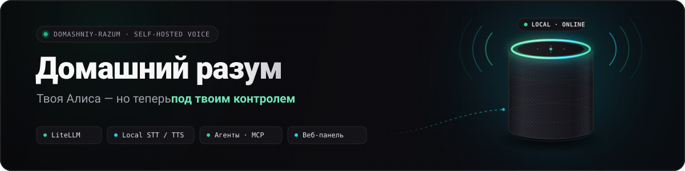
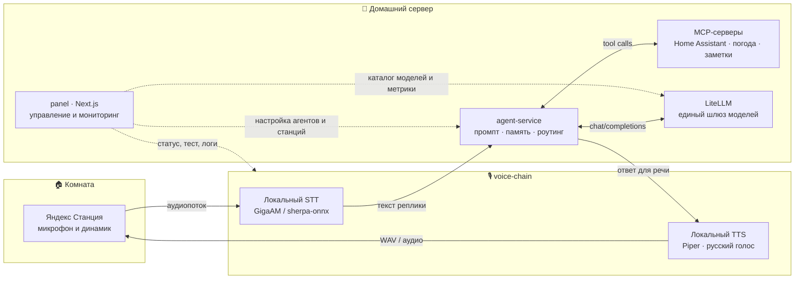

<p align="center">
  
  
  
  
  
  
</p>

**Домашний разум** (`domashniy-razum`) — домашний голосовой стек и инженерный веб-пульт для умных колонок Яндекс Станция. Из динамика отвечает **твоя модель** через домашний LiteLLM, речь распознаётся и синтезируется **локально**, а характер, системный промпт и инструменты настраиваются под каждую комнату.

Колонка остаётся привычным предметом в интерьере, но полностью переходит под контроль владельца — **Алиса больше не решает**, что отвечать, какие сервисы вызывать и куда отправлять голос.

---

## Что это

Репозиторий объединяет три слоя, которые превращают домашние колонки в открытый голосовой интерфейс к собственным LLM и умному дому:

- **`panel/`** — тёмный веб-пульт на Next.js 15 и TypeScript: статус станций и сервисов, выбор моделей, визуальный конструктор агентов, подключение MCP-серверов, живой тест диалога и просмотр логов.
- **`agent-service/`** — легковесный OpenAI-совместимый шлюз агентов (Node.js + SQLite + MCP SDK). Принимает текст запроса, подставляет персону и контекст комнаты, вызывает инструменты по Model Context Protocol и общается с домашним LiteLLM.
- **`voice-chain/`** — конфигурация локального голосового контура (`STT → Agent / LiteLLM → TTS`) на базе офлайн-движков распознавания и синтеза речи (GigaAM / sherpa-onnx + Piper TTS) с русским фонетическим словарём.

---

## Зачем

Умные колонки отлично справляются с микрофонами в дальнем поле и звуком, но привязаны к закрытому облачному сценарию: нельзя сменить языковую модель, нельзя убрать лишнюю болтливость или навязчивые рекомендации, нельзя напрямую выдать колонке доступ к домашним базам, заметкам и локальным скриптам.

**Домашний разум** разделяет железо и интеллект:

1. **Свобода выбора модели.** Сегодня на кухне отвечает быстрая локальная модель, завтра в кабинете — флагманская рассуждающая модель через единый роутер LiteLLM.
2. **Приватность и предсказуемость.** Голосовой контур STT/TTS крутится дома, промпты и ключи хранятся на вашем сервере, а ответы звучат ровно так, как вы настроили.
3. **Настоящие действия, а не зашитые сценарии.** Через MCP колонка получает ровно те инструменты, которые вы разрешили конкретному агенту.

---

## Возможности

- 🎙 **Собственный голосовой тракт** — локальное распознавание речи (STT) и офлайн-синтез голоса (TTS) без привязки к облачному ассистенту.
- 🧠 **Любые LLM через LiteLLM** — OpenAI-совместимый вход позволяет переключать локальные и облачные модели на лету без перенастройки колонок.
- 🤖 **Персональные агенты по комнатам** — отдельные роли для гостиной, кухни, кабинета или детской со своим системным промптом, температурой и тоном подачи.
- 🔌 **Поддержка MCP (Model Context Protocol)** — подключение внешних и домашних инструментов по `stdio`, `SSE` и `HTTP` с точечной выдачей прав на каждый инструмент.
- 🗣 **Адаптация текста под живую озвучку** — встроенные правила устной речи: короткие реплики без списков и markdown-разметки, числительные словами, настраиваемые фразы ожидания при долгих вызовах.
- 🎛 **Инженерная веб-панель** — контроль задержек по этапам (`STT / LLM / TTS`), проверка доступности узлов, песочница для отладки агента без похода к колонке и потоковые логи.

---

## Архитектура

Весь маршрут от произнесённой фразы до аудиоответа в динамике замыкается внутри домашней сети:



| Каталог | Назначение | Стек | Порт по умолчанию |
| :--- | :--- | :--- | :--- |
| `panel/` | Веб-интерфейс управления колонками, агентами и моделями | Next.js 15, React 19, Tailwind v4, TypeScript | `3110` (`3000` в контейнере) |
| `agent-service/` | Исполнение агентов, хранение конфигураций, вызов MCP-инструментов | Node.js 22+, Express, SQLite, `@modelcontextprotocol/sdk` | `4100` |
| `voice-chain/` | HTTP/WS-сервис распознавания, синтеза и сквозного цикла `/api/ask` | Python / `belch-voice`, `sherpa-onnx`, `espeak-ng` | `10702` |
| `docs/` | Проектные заметки, UX-спецификации и история запуска на железе | Markdown | — |

---

## Быстрый старт

> **Честно о пороге входа:** это не коробочное приложение «в один клик», а живой домашний self-hosted проект. Подразумевается, что у вас в локальной сети уже работает **LiteLLM** (или другой OpenAI-совместимый прокси), есть Docker / Node.js 22+, а колонка уже переведена на работу с локальным мостом.

### 1. Подготовить общую Docker-сеть

Контейнеры панели и сервиса агентов общаются с LiteLLM в единой сети `home`:

```bash
docker network create home || true
```

### 2. Запустить сервис агентов (`agent-service`)

```bash
cd agent-service
mkdir -p secrets/agent

# При необходимости добавьте переменные для MCP-серверов в secrets/agent/mcp.env
docker compose up -d --build
```

Проверка готовности: `curl http://localhost:4100/health`.

### 3. Поднять голосовой контур (`voice-chain`)

Отредактируйте `voice-chain/config.yaml` под свой адрес LiteLLM / `agent-service` и пути к локальным моделям STT/TTS, после чего запустите сервис голосового стека (на macOS предусмотрен готовый шаблон `launchd` в `voice-chain/`).

Проверка готовности: `curl http://localhost:10702/api/health`.

### 4. Запустить веб-панель (`panel`)

```bash
cd panel
cp .env.example .env
```

Заполните `.env` своими локальными адресами (`LITELLM_BASE_URL`, `LITELLM_API_KEY`, `VOICE_CHAIN_URL`) и запустите панель:

```bash
# В Docker:
docker compose up -d --build

# Или локально для разработки:
pnpm install && pnpm dev
```

После старта пульт открывается на `http://localhost:3110`.

---

## Как это работает

Чтобы колонка перестала полагаться на облачный сценарий и начала отправлять звук в локальный контур и воспроизводить синтезированный дома ответ, на стороне устройства работает связующий мост, а вся логика диалога вынесена на домашний сервер.

Логика диалога, персоны и инструменты живут на домашнем сервере. Как устроены агенты и права на MCP — в [`docs/agent-ux.md`](docs/agent-ux.md).

Подробная методичка по вскрытию колонки и настройке station-setup:

- [Как это работает](docs/how-we-took-over.md)

---

## Агенты и MCP

Вместо одной «универсальной» личности в **Домашнем разуме** работают настраиваемые **агенты**. Каждой колонке можно назначить своего собеседника:

- **Персона и контекст.** В системный промпт автоматически подставляются переменные окружения: `{{station_name}}`, `{{room}}`, `{{time}}`, `{{date}}`, `{{user_name}}` — агент знает, в какой он комнате и который сейчас час.
- **Голосовая гигиена.** То, что хорошо читается глазами в чате, ужасно звучит из динамика. Для агентов включается режим устной речи: ёмкие ответы в 1–3 предложения, запрет на списки и спецсимволы, естественная запись чисел и единиц измерения, а также короткие реплики-перебивки (*«Секунду, сверюсь…»*), если внешний инструмент думает дольше обычного.
- **Инструменты MCP с контролем прав.** К `agent-service` подключаются любые серверы Model Context Protocol (`HTTP / Streamable`, `SSE`, `stdio`). В панели можно гранулярно отметить чекбоксами, какие именно функции разрешены конкретному агенту: например, агент в гостиной управляет светом и климатом в Home Assistant, а детский рассказчик в спальне не имеет доступа к замкам и выключателям.

Детальное описание интерфейса редактора агентов и работы с инструментами — в [`docs/agent-ux.md`](docs/agent-ux.md).

---

## Скриншоты

> Интерфейс выдержан в эстетике спокойного тёмного инженерного пульта (`zinc-950`, моноширинные индикаторы телеметрии, мгновенная обратная связь без визуального шума). Скриншоты живого стенда будут добавлены в `assets/screenshots/`.

| Экран | Файл (плейсхолдер) | Что внутри |
| :--- | :--- | :--- |
| **Пульт и станции** | `assets/screenshots/dashboard.png` | Сводка состояния LiteLLM, голосового стека и колонок по комнатам, задержка последнего ответа и быстрое переключение активного агента. |
| **Редактор агента и MCP** | `assets/screenshots/agent-editor.png` | Настройка персоны, системного промпта с чипами переменных, выбор модели, правила устной озвучки и дерево чекбоксов инструментов MCP. |
| **Песочница и логи тракта** | `assets/screenshots/voice-test.png` | Проверка ответа агента текстом или голосом прямо из браузера с разбивкой таймингов `STT → Tools → LLM → TTS` и просмотром сырых вызовов. |

---

## Лицензия

Проект распространяется под лицензией **MIT**. Используйте, адаптируйте под свою домашнюю инфраструктуру и делитесь улучшениями.

*Независимый любительский проект для локальной автоматизации. Не связан с компанией Яндекс; все упомянутые товарные знаки принадлежат их законным правообладателям.*
